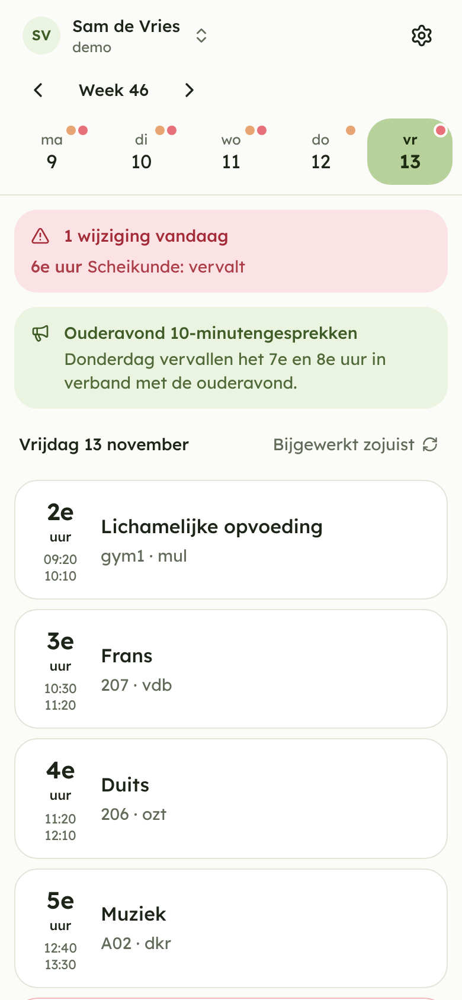
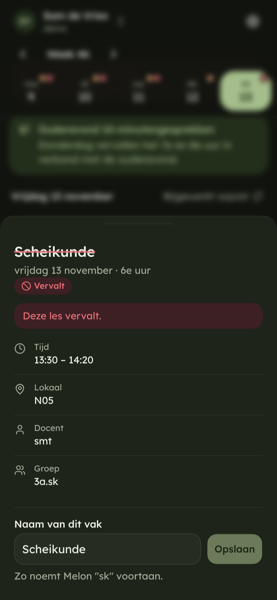
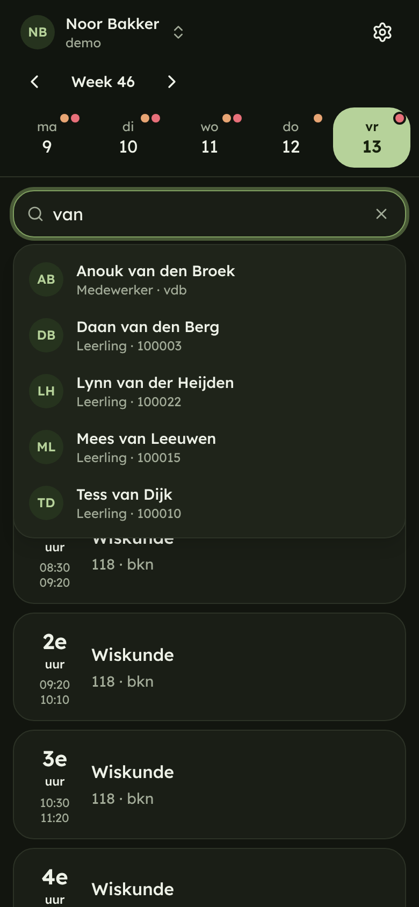

# Melon

Zermelo, but intuitive. A web app, a cleaner API and an MCP server on top of
[Zermelo Portal](https://www.zermelo.nl/), in one Go binary.

| | | |
|---|---|---|
|  |  |  |

More in [`docs/screenshots`](docs/screenshots). They are generated by CI from demo data.

## What you get

- **Web app** (`/`): mobile-first schedule with changes you cannot miss, multiple
  linked accounts with quick switching, student/teacher search for accounts that
  may see others, subject renaming, Dutch by default with English optional,
  light and dark mode.
- **REST API** (`/api/v1`, reference at `/docs`, spec at `/api/openapi.yaml`):
  sensible resources, one response shape, readable subject names, real errors.
- **MCP server** (`/mcp`, Streamable HTTP): the same functionality for AI
  clients. Log in with OAuth (pick which linked accounts to share) or an API key.
- **Calendar feed** (`/calendar/<secret>.ics`): subscribe from any calendar app.

Melon is read-only towards Zermelo. The one POST it ever sends is exchanging a
link code for a token.

## Run it

```sh
docker run -p 8080:8080 -v melon-data:/data \
  -e MELON_SECRET="$(openssl rand -base64 32)" \
  -e MELON_PUBLIC_URL=https://melon.example.com \
  ghcr.io/matthiaslubbertsen/melon:latest
```

Keep `MELON_SECRET` somewhere safe: it encrypts the stored Zermelo tokens, and
losing it means everyone has to link again.

| Variable | Default | Meaning |
|---|---|---|
| `MELON_SECRET` | generated into the data dir | Master key for encrypting tokens at rest. Set it in production. |
| `MELON_PUBLIC_URL` | derived from the request | External origin, used in OAuth metadata and calendar links. |
| `MELON_ADDR` | `:8080` | Listen address. |
| `MELON_DATA_DIR` | `./data` (`/data` in Docker) | SQLite database location. |
| `MELON_TRUST_PROXY` | off | Trust `X-Forwarded-*` headers (set behind a reverse proxy). |
| `MELON_DEFAULT_SCHOOL` | none | Portal name (e.g. `jfc`) prefilled in the school field. Users can still change it. |
| `MELON_DEMO` | off | Enables the generated demo school and the "Bekijk de demo" button. |
| `MELON_TIMEZONE` | `Europe/Amsterdam` | School timezone. |

## Develop

```sh
cd web && npm install && npm run build && cd ..   # build the app that Go embeds
MELON_DEMO=1 go run ./cmd/melon                    # http://localhost:8080
cd web && npm run dev                              # hot reload, proxies to :8080
go test ./...
```

Layout: `cmd/melon` (entry point), `internal/zermelo` (upstream client, rate
limiting, cache, demo school), `internal/core` (domain logic shared by REST, MCP
and the calendar feed), `internal/server` (HTTP, OAuth, MCP), `internal/store`
(SQLite), `internal/secret` (encryption, hashing), `web` (React + shadcn/ui).

## Using the API

Create a key in the app under *Instellingen → Koppelingen*, then:

```sh
curl -H "Authorization: Bearer melon_sk_..." https://melon.example.com/api/v1/accounts
curl -H "Authorization: Bearer melon_sk_..." \
  "https://melon.example.com/api/v1/accounts/acc_.../schedule?from=today&changesOnly=true"
```

## Using the MCP server

Add `https://melon.example.com/mcp` as a remote MCP server. Clients that support
OAuth get a consent screen where you choose the accounts to share. Clients that
do not can send an API key as a Bearer token. Tools: `list_accounts`,
`get_schedule`, `search_people`, `get_announcements`, `list_subjects`,
`rename_subject`.

## Design decisions

- **No Melon passwords.** A profile is the browser it lives in (a long-lived,
  HttpOnly cookie). Linking the same Zermelo account on another device creates a
  separate profile on purpose: merging would let anyone holding one account's
  token see every other account linked next to it.
- **Secrets.** Zermelo tokens are AES-256-GCM encrypted, bound to their row, and
  never leave the server. API keys, sessions and OAuth tokens are stored only as
  SHA-256 hashes; a key is shown once. Calendar feed secrets are encrypted so the
  URL can be shown again, and can be regenerated.
- **Freshness.** Zermelo answers are cached for 30 seconds (5 second floor on
  manual refresh), concurrent requests are de-duplicated, and each school has
  its own rate limit (4 requests/second, bursts of 8) with back-off on HTTP 429.
  If Zermelo is down, the last answer (max 30 minutes old) is served and clearly
  marked stale. The app refetches on focus, every minute, and on pull-to-refresh.
- **Wide access** is detected when linking: if the token can list more than its
  own user, the account gets a search bar.
- **MCP auth** is OAuth 2.1 with dynamic client registration, mandatory PKCE,
  one-hour access tokens and rotating refresh tokens.
